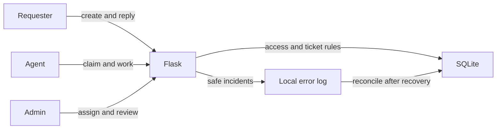

# Team Tickets

Team Tickets is a local Flask demo for handling requests in a small team. Requesters create tickets and confirm the outcome. Agents claim unassigned tickets and work on them. Admins manage assignments, review ticket history, and inspect safe application error summaries.

## Run on Windows

Requires Python 3.10 or later. Open PowerShell in this project folder and run:

```powershell
py -m venv .venv
.\.venv\Scripts\python -m pip install -r requirements.txt
$env:TICKET_SECRET_KEY = & .\.venv\Scripts\python -c "import secrets; print(secrets.token_hex(32))"
.\.venv\Scripts\python -m scripts.init_db
$env:TICKET_DEMO_PASSWORD = 'TiketDemoLokal2026!'
.\.venv\Scripts\python -m scripts.seed_demo
.\.venv\Scripts\python -m flask --app app run --host 127.0.0.1
```

Open `http://127.0.0.1:5000`. Use the password set in `TICKET_DEMO_PASSWORD` for these fictional accounts:

| Role | Email |
|---|---|
| Requester | `rina.demo@example.test` |
| Agent | `budi.demo@example.test` |
| Admin | `sari.demo@example.test` |

The secret key and demo password above are for local use only. Changing the secret key ends existing login sessions. Do not use these accounts or passwords with real data. The database, reset-code outbox, and error logs stay in `instance/`, which Git ignores.

If you already have a demo database, back up `instance/tickets.sqlite3` and run `scripts.init_db` again. The migration preserves existing tickets and history. Older tickets receive the initial urgency `Normal` without assessment answers; this is not an automatic classification. Skip `scripts.seed_demo` when demo accounts already exist. To restart the app later, set `TICKET_SECRET_KEY` and run the Flask command above.

## Accounts and password reset

On the sign-in page, choose **Create requester account**. New public accounts are always requesters. Enter a name, email, and password of at least 12 characters. Email is a login identifier in this demo. The app does not verify address ownership or connect to Gmail.

Choose **Forgot password?** to request a reset code. The page gives the same response for registered and unregistered addresses. For an active account, a one-use code is written to the local demo outbox. It expires after 30 minutes. From PowerShell in the project folder, read it with:

```powershell
.\.venv\Scripts\python -m scripts.show_demo_mail --email rina.demo@example.test
```

Replace the example address with the account email. Enter the code on the **Enter reset code** page and choose a new password. A successful reset invalidates older sessions and the used code. Requests for another code are limited to one per account every five minutes.

The outbox is `instance/demo-reset-mail.jsonl` and contains raw reset codes for this local demo. Keep that file private. Sending real email would require an email provider and address verification; neither is implemented.

### Agent and admin accounts

An existing admin creates agent and admin accounts from **Team accounts**. Public registration cannot choose either role. The admin sets an initial password and gives it directly to the account owner; the app does not email it.

For a fresh database without seeded accounts, create the first admin after running `scripts.init_db`:

```powershell
.\.venv\Scripts\python -m scripts.create_first_admin
```

The script prompts for a name, email, and password without displaying the password as you type. It refuses to create another first admin once one exists. If you seeded the demo, Sari is already the first admin.

## Ticket workflow



A ticket moves from `open` to `in_progress`, `resolved`, and `closed`. Its requester can reopen a resolved or closed ticket. Assignment is separate from work status. Claiming or assigning a ticket does not start work.

### Urgency assessment

The requester answers whether their main work is blocked, whether a workaround exists, and what happens if help is delayed. The app sets an initial urgency using these rules:

| Level | Rule |
|---|---|
| High | Waiting has a serious impact, or work is blocked with no workaround. |
| Normal | Work is blocked but a workaround exists, or waiting disrupts some work. |
| Low | Other cases with minor impact. |

The unassigned queue shows High, then Normal, then Low. Older tickets come first within each level. An admin can change urgency from the ticket page with a required reason. The change increases the ticket version and appears in its history. Urgency does not change status or assignment. This assessment uses structured answers, not AI, and does not promise a response time or SLA. Team members should review answers that may be wrong or outdated.

### Try the demo

1. Sign in as Rina and create a ticket. Answer the three urgency questions. The new ticket is open and unassigned.
2. Sign in as Budi in another browser window. Open **Unassigned queue**, claim the ticket, start work, and mark it resolved.
3. Sign in as Rina again. Confirm and close the ticket, or reopen it with a reason.
4. Sign in as Sari. Create an agent under **Team accounts**, assign or reassign tickets, change urgency with a reason, view ticket history, and review a demo error.

If two agents claim the same ticket, only one claim succeeds. The other form receives HTTP `409` and must reload. Status and assignment changes also use the ticket version to reject stale forms.

Browser screenshots from the demo: [admin ticket list](docs/urgency-admin-list.png) and [urgency change history](docs/urgency-history.png). The shown tickets are fictional.

## Tests

```powershell
.\.venv\Scripts\python -m unittest discover -s tests -v
.\.venv\Scripts\python -m compileall -q app scripts tests
.\.venv\Scripts\python -m pip check
```

Tests create temporary databases. They do not modify `instance/tickets.sqlite3`.

## Read the code

1. Start with `app/__init__.py` for configuration, CSRF protection, routes, and error responses.
2. Read `app/schema.sql`, `app/db.py`, and `scripts/init_db.py` for tables, constraints, indexes, and database setup.
3. Compare `app/auth.py` and `app/admin.py`. Public registration creates only requesters; admins create team accounts. Password reset increments the session version so older sessions stop working.
4. Read `app/tickets.py` next to `app/ticket_ops.py`. Routes handle HTTP and pages; ticket operations check access, urgency rules, status transitions, versions, transactions, and history. `tests/test_urgency.py` covers those rules and the older-database migration.
5. Look at the conditional claim update in `app/ticket_ops.py`. It succeeds only while a ticket is open, unassigned, and at the expected version. `tests/test_concurrency.py` uses separate connections to test competing claims.
6. Read `app/admin.py` and `app/error_logging.py`. Error events are kept separately from review status and append-only notes. `tests/test_error_logging.py` exercises fallback logging and reconciliation.

To experiment, change one rule in a copy, run the related test, and restore it if the result is wrong. The tests use temporary databases, so they do not disturb the main demo data.

## Data and limits

Main tables: `users`, `password_reset_tokens`, `tickets`, `comments`, `ticket_events`, `error_events`, `error_reviews`, and `error_review_notes`. Tickets store urgency and the three assessment answers. Ticket events record initial urgency and changes with their reasons. The app has no routes to edit or delete ticket or error events. Error review status and notes are stored separately from the original event.

The app writes filtered error incidents to a local rotating file before attempting to store them in SQLite. After a database outage, run `.\.venv\Scripts\python -m scripts.reconcile_errors` to import missing incidents. Unique incident IDs make repeat runs safe.

The initial demo retention target is 90 days for database error events and 30 days for fallback files. Cleanup is not automatic. The fallback file rotates at about 1 MiB with three copies, so heavy error traffic may replace older incidents sooner. Tickets, comments, and ticket history have no delete feature in this MVP.

Before using real data, review retention, backups, email verification and delivery, login limits, HTTPS, and server operations. This demo has no attachments, automatic notifications, SLA, multiple teams, or public JSON API. Existing user-written tickets and historical events keep their original language.
