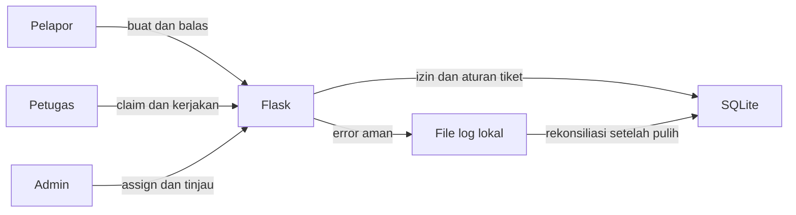

# Tiket Tim

Aplikasi demo lokal untuk menerima dan menangani permintaan dalam satu tim kecil. Pelapor membuat tiket dan mengonfirmasi hasil. Petugas mengambil tiket dari antrean. Admin dapat menugaskan petugas serta meninjau riwayat dan error aplikasi.

## Menjalankan di Windows

Memerlukan Python 3.10 atau lebih baru. Dari folder proyek, jalankan di PowerShell:

```powershell
py -m venv .venv
.\.venv\Scripts\python -m pip install -r requirements.txt
$env:TICKET_SECRET_KEY = & .\.venv\Scripts\python -c "import secrets; print(secrets.token_hex(32))"
.\.venv\Scripts\python -m scripts.init_db
$env:TICKET_DEMO_PASSWORD = 'TiketDemoLokal2026!'
.\.venv\Scripts\python -m scripts.seed_demo
.\.venv\Scripts\python -m flask --app app run --host 127.0.0.1
```

Buka `http://127.0.0.1:5000`. Gunakan kata sandi yang diset pada `TICKET_DEMO_PASSWORD` untuk ketiga akun fiktif:

| Role | Email |
|---|---|
| Pelapor | `rina.demo@example.test` |
| Petugas | `budi.demo@example.test` |
| Admin | `sari.demo@example.test` |

Nilai `TICKET_SECRET_KEY` dan `TICKET_DEMO_PASSWORD` di atas hanya untuk demo lokal. Sesi login akan berakhir saat secret key diganti. Jangan menggunakan akun demo atau kata sandi ini untuk data nyata. Database dan log tersimpan di `instance/`, yang dikecualikan dari Git.

Jika database demo sudah ada, cadangkan file `instance/tickets.sqlite3`, lalu jalankan ulang `scripts.init_db`. Migrasi menambah penilaian urgensi tanpa menghapus tiket atau riwayat lama. Tiket lama diberi tingkat awal **Normal** dengan jawaban penilaian kosong; ini bukan hasil klasifikasi otomatis. Lewati `scripts.seed_demo` karena akun contoh sudah tersedia. Untuk menyalakan aplikasi lagi, cukup set `TICKET_SECRET_KEY` dan jalankan perintah `flask run` di atas.

## Membuat akun dan mengganti kata sandi

Pada halaman masuk, pilih **Buat akun pelapor**. Isi nama, email, dan kata sandi minimal 12 karakter. Akun baru selalu berperan sebagai pelapor. Email hanya identitas login; aplikasi ini tidak terhubung ke Gmail dan belum memverifikasi kepemilikan alamat.

Jika lupa kata sandi, pilih **Lupa kata sandi?** dan masukkan email. Halaman akan memberi respons sama untuk alamat yang terdaftar maupun yang tidak, agar keberadaan akun tidak terungkap. Untuk alamat aktif, kode sekali pakai berlaku 30 menit dan disimpan di kotak surat demo lokal. Dari PowerShell di folder proyek, jalankan:

```powershell
.\.venv\Scripts\python -m scripts.show_demo_mail --email rina.demo@example.test
```

Ganti alamat contoh dengan email akun yang meminta reset. Salin kode ke halaman **Masukkan kode reset**, lalu buat kata sandi baru. Setelah berhasil, kode tidak bisa digunakan lagi dan sesi login lama untuk akun itu berhenti berlaku. Permintaan kode baru untuk akun yang sama dibatasi menjadi satu tiap lima menit.

Kotak surat demo berada di `instance/demo-reset-mail.jsonl`, di luar Git. Isinya kode reset mentah untuk keperluan demo lokal; hanya jalankan aplikasi pada komputer sendiri dan jangan membagikan file tersebut. Untuk pengiriman email sungguhan, aplikasi memerlukan layanan email yang dikonfigurasi dan verifikasi alamat. Fitur itu belum ada.

## Akun petugas dan admin

Pelapor membuat akun sendiri dari halaman masuk. Petugas dan admin dibuat oleh admin yang sudah ada:

1. Masuk sebagai admin. Pada data demo, gunakan akun Sari pada tabel di atas.
2. Buka **Akun tim** di menu samping. Isi nama, email, peran **Petugas** atau **Admin**, serta kata sandi awal.
3. Berikan kata sandi awal secara langsung kepada pemilik akun. Aplikasi tidak mengirimkannya melalui email. Pemilik akun dapat masuk dengan email tersebut dan mengganti kata sandinya melalui alur reset demo.

Pada database baru tanpa akun demo, buat admin pertama setelah menjalankan `scripts.init_db`:

```powershell
.\.venv\Scripts\python -m scripts.create_first_admin
```

Perintah ini meminta nama, email, dan kata sandi di terminal; kata sandi tidak ditampilkan saat diketik. Perintah menolak membuat admin kedua. Jika Anda sudah menjalankan `scripts.seed_demo`, admin pertama adalah Sari, sehingga gunakan halaman **Akun tim** untuk akun tambahan.

## Alur sistem



Status tiket berjalan dari `open` ke `in_progress`, `resolved`, lalu `closed`. Pelapor dapat membuka kembali tiket `resolved` atau `closed` ke `open`. Penugasan petugas disimpan terpisah dari status.

## Penilaian urgensi

Saat membuat tiket, pelapor menjawab apakah pekerjaan utama terhenti, apakah ada cara sementara, dan seberapa besar dampak jika penanganan menunggu. Sistem langsung menentukan tingkat awal dengan aturan berikut:

| Tingkat | Aturan |
|---|---|
| Tinggi | Dampak menunggu serius, atau pekerjaan terhenti tanpa cara sementara. |
| Normal | Pekerjaan terhenti tetapi ada cara sementara, atau dampak menunggu mengganggu sebagian pekerjaan. |
| Rendah | Kondisi lainnya, dengan dampak menunggu kecil. |

Antrean tanpa petugas mengurutkan tiket Tinggi, Normal, lalu Rendah; dalam tingkat yang sama, tiket lebih lama didahulukan. Admin dapat mengubah tingkat dari detail tiket dengan alasan wajib. Perubahan itu menaikkan versi tiket dan tercatat di riwayat. Tingkat urgensi tidak mengubah status atau petugas. Sistem ini hanya memakai jawaban terstruktur pelapor; belum membaca isi deskripsi dengan AI, dan belum menetapkan tenggat/SLA. Tim tetap perlu memeriksa jawaban yang keliru atau berubah.

## Alur yang dapat dicoba

1. Masuk sebagai Rina dan buat tiket. Jawab tiga pertanyaan penilaian. Tiket muncul dengan status Terbuka tanpa petugas dan tingkat urgensi awal.
2. Masuk sebagai Budi di jendela browser lain, buka Antrean, ambil tiket, lalu mulai kerja dan tandai selesai. Claim tidak mengubah status dengan sendirinya.
3. Masuk sebagai Rina, buka tiket itu, lalu konfirmasi dan tutup atau buka kembali dengan alasan.
4. Masuk sebagai Sari untuk membuat akun petugas di **Akun tim**, menugaskan atau memindahkan tiket, mengoreksi urgensi dengan alasan, melihat riwayat, dan meninjau error demo. Alasan wajib saat petugas lama diganti atau dilepas.

Jika dua petugas mengambil tiket yang sama, hanya satu claim berhasil. Form lain mendapat `409` dan perlu memuat ulang. Perubahan status serta penugasan memakai versi tiket untuk menolak form yang sudah usang.

Tangkapan layar dari uji browser lokal: [daftar tiket admin](docs/urgency-admin-list.png) dan [riwayat koreksi urgensi](docs/urgency-history.png). Data pada gambar bersifat fiktif.

## Tes

```powershell
.\.venv\Scripts\python -m unittest discover -s tests -v
.\.venv\Scripts\python -m compileall -q app scripts tests
.\.venv\Scripts\python -m pip check
```

Tes memakai database sementara, bukan `instance/tickets.sqlite3`.

## Memahami implementasi langkah demi langkah

1. Baca `app/__init__.py` untuk melihat bagaimana Flask menyiapkan konfigurasi, proteksi CSRF, route, dan penanganan error.
2. Baca `app/schema.sql`, lalu `app/db.py` dan `scripts/init_db.py`. Cocokkan foreign key, constraint, dan indeks dengan tabel yang muncul di database.
3. Baca `app/auth.py` dan `app/admin.py`: pendaftaran umum selalu membuat pelapor, sedangkan route admin membuat petugas atau admin. Login menyimpan ID dan versi sesi; reset kata sandi menaikkan versi sesi agar sesi lama tidak berlaku.
4. Buka `app/tickets.py` dan `app/ticket_ops.py` berdampingan. Route mengurus HTTP dan tampilan; operasi tiket memeriksa izin, klasifikasi urgensi, aturan status, versi, transaksi, serta menulis riwayat. Jalankan `tests/test_urgency.py` untuk melihat contoh setiap aturan dan migrasi data lama.
5. Perhatikan claim di `app/ticket_ops.py`: pembaruan hanya berhasil bila tiket masih `open`, belum ditugaskan, dan versinya cocok. Jalankan `tests/test_concurrency.py` untuk melihat dua koneksi berebut tiket yang sama.
6. Baca `app/admin.py` dan `app/error_logging.py`. Bandingkan kejadian error yang tetap dengan status tinjauan serta catatan yang dapat ditambah. Jalankan `tests/test_error_logging.py` untuk mencoba fallback dan rekonsiliasi.

Ubah satu aturan kecil di salinan kerja, jalankan tes terkait, lalu kembalikan jika tes gagal. Contoh: periksa mengapa membuka kembali tiket tidak menghapus petugasnya. Jangan mencoba eksperimen pada database demo utama; tes selalu membuat database sementara.

## Data dan batas sistem

Tabel utama: `users`, `password_reset_tokens`, `tickets`, `comments`, `ticket_events`, `error_events`, `error_reviews`, dan `error_review_notes`. `tickets` menyimpan tingkat urgensi serta tiga jawaban penilaian; `ticket_events` menyimpan tingkat awal dan perubahan berikut alasannya. `ticket_events` dan `error_events` tidak memiliki route ubah atau hapus. Status peninjauan serta catatan error terpisah dari kejadian aslinya. Error yang telah disaring ditulis ke file lokal sebelum dicoba masuk ke database. Setelah database pulih, jalankan `.\.venv\Scripts\python -m scripts.reconcile_errors` dari folder proyek untuk memasukkan kejadian yang belum ada. Perintah ini aman dijalankan ulang karena ID kejadian unik.

Target retensi demo adalah 90 hari untuk error dalam database dan 30 hari untuk file fallback. Pembersihan otomatis belum diterapkan; operator demo perlu meninjau dan membersihkan data secara manual. File fallback berotasi pada sekitar 1 MiB dengan tiga salinan, jadi error lama bisa tergeser sebelum 30 hari bila volume error tinggi. Tiket, komentar, dan riwayat tidak mempunyai fitur hapus pada MVP. Sebelum dipakai dengan data nyata, tentukan kebijakan retensi, backup, verifikasi email, pengiriman reset melalui penyedia email, pembatasan login, HTTPS, dan operasi server. Aplikasi ini belum menyediakan lampiran, notifikasi, SLA, banyak tim, atau API JSON publik.
